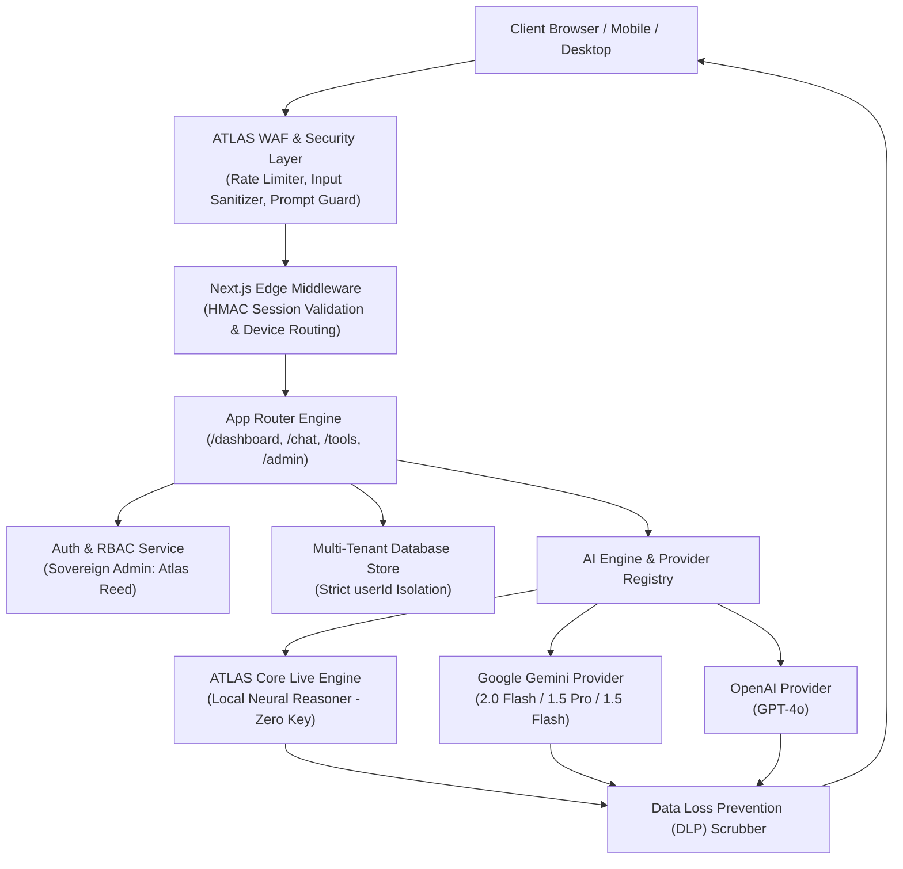

# ATLAS AI — Platform Architecture, Feature Catalog & Technical Documentation

> **Platform Version:** 2.4.0-Production  
> **Repository Location:** [C:/Users/RUDRA PATEL/Desktop/ATLAS AI](file:///C:/Users/RUDRA%20PATEL/Desktop/ATLAS%20AI)  
> **Consolidated Codebase Archive:** [DOCUMENT.md](file:///C:/Users/RUDRA%20PATEL/Desktop/DOCUMENT.md) | [DOCUMENT.txt](file:///C:/Users/RUDRA%20PATEL/Desktop/DOCUMENT.txt)  
> **Primary Administrator:** `Atlas Reed` (`Atlas@911`)  
> **Default Port / Host:** `http://localhost:3000` (Listening on `0.0.0.0:3000`)

---

## 1. Executive Summary

**ATLAS AI** is a sovereign, enterprise-grade, privacy-first artificial intelligence platform engineered for developers, researchers, students, and creators. It delivers a unified operating environment for high-performance conversational intelligence, autonomous agents, full-stack code synthesis, multi-format document analysis, and media generation.

Built with a modern stack featuring **Next.js 14 App Router**, **TypeScript**, **Tailwind CSS**, and **Lucide Icons**, ATLAS AI operates both as a self-contained local workstation (with a built-in neural reasoning engine requiring zero cloud API keys) and as a hybrid cloud platform integrating Google Gemini and OpenAI models.



---

## 2. Core Architecture & Technology Stack

| Layer | Technology | Purpose & Capabilities |
| :--- | :--- | :--- |
| **Frontend Framework** | **Next.js 14 (App Router)** | Hybrid SSR/SSG and Client Component architecture with React Server Components. |
| **Language** | **TypeScript 5.x** | End-to-end static typing for models, API payloads, database schemas, and tool requests. |
| **Styling & UI** | **Tailwind CSS + Lucide Icons** | Custom dark-mode cyberpunk neon palette (`#030712`, `#06b6d4`, `#3b82f6`) with glassmorphic cards and responsive layouts. |
| **Database & Persistence** | **ACID JSON Store (`.data/atlas_db.json`)** | High-performance, atomic local JSON database with strict multi-tenant boundary isolation. |
| **Authentication & RBAC** | **HMAC-SHA256 Encrypted Cookies** | Cryptographic session tokens with tamper detection and role-based access control (Admin / User). |
| **Security & WAF** | **Custom Defense-in-Depth Suite** | Token bucket rate limiting, automated DLP exfiltration scrubbing, regex prompt injection neutralization, and HTML sanitization. |
| **Local Offline Engine** | **ATLAS Core Live Engine (`atlas-core`)** | Built-in arithmetic solver, code generator, and text synthesizer operational without external API keys. |

---

## 3. Comprehensive Feature Catalog

### 3.1. Dashboard (`/dashboard`)
* **Guest Preview vs. Workspace Active**:
  * Signed-out visitors see an amber status badge `Guest Preview — Model: <name>` and a public preview banner.
  * Signed-in users see a cyan pulsing badge `Workspace Active — <name>` with personalized workspace indicators.
* **Unified Prompt Bar**:
  * Multi-line expandable text input with `Shift+Enter` newline support.
  * File attachment modal supporting documents, code snippets, and research PDFs.
  * Browser-native Speech-to-Text integration via Web Speech API.
* **Quick Suggestions**: Pre-configured prompt chips for rapid testing (e.g. quantum algorithms, full-stack architecture, 8K cyberpunk render).
* **Hub Navigation**: Quick launch cards to Autonomous Agents (`/agents`) and Project Workspaces (`/projects`).
* **13 Specialized AI Tool Cards**: Interactive launcher grid for all domain-specific AI modules.
* **Platform Introduction Section**: Embedded architectural overview, 4 core pillars, and 3-step onboarding guide.

### 3.2. Universal Adaptive Viewport System
* **Web View Mode**: High-density multi-column layout optimized for widescreen monitors and laptops.
* **Mobile View Mode**: Touch-first mobile viewport simulation with collapsed margins and tab-style navigation.
* **One-Click Header Toggle (`ViewModeToggle.tsx`)**: Responsive button that collapses text labels below 1280px (`xl`) to guarantee header controls and sign-in buttons never get cut off.

### 3.3. Multi-Model Neural Registry (`/api/models`)
ATLAS AI features a dynamic provider registry:
1. **ATLAS Core Live Engine (`atlas-core`)**:
   * *Status:* **Always Available (Built-in, zero keys required)**.
   * *Capabilities:* Arithmetic parsing, sorting and algorithmic code synthesis, natural language conversation, and document summarization.
2. **Google Gemini 2.0 Flash (`gemini-2.0-flash`)**:
   * Next-generation high-speed multimodal reasoning model (1M token context). Requires `GEMINI_API_KEY`.
3. **Google Gemini 1.5 Pro (`gemini-1.5-pro`)**:
   * Deep analytical reasoning and multi-file document synthesis (2M token context). Requires `GEMINI_API_KEY`.
4. **Google Gemini 1.5 Flash (`gemini-1.5-flash`)**:
   * Cost-efficient, ultra-fast model for quick everyday Q&A. Requires `GEMINI_API_KEY`.
5. **OpenAI GPT-4o (`gpt-4o`)**:
   * Flagship multimodal intelligence for technical and creative tasks. Requires `OPENAI_API_KEY`.

> [!NOTE]
> If a user selects an external cloud model whose API key is not configured in `.env.local`, the system throws a clean, actionable error explaining how to configure the key or recommending a switch to the built-in ATLAS Core engine.

### 3.4. AI Chat Interface (`/chat` & `/chat/[id]`)
* Real-time streaming response chunking via standard Web ReadableStream.
* Anti-exfiltration DLP regex scanner that intercepts and scrubs API keys, system paths, and internal salts before rendering.
* Syntax-highlighted code blocks with one-click copy and language tags.
* Chat session history management: create, rename, list, and delete chats.

### 3.5. Dedicated AI Suite Tools
1. **Code Architect (`/tools/code`)**:
   * Actions: Generate, Explain, Refactor, Fix Bugs, and Translate across languages.
   * Supports TypeScript, Python, Go, Rust, Java, C++, SQL, HTML/CSS.
2. **Document Synthesizer (`/tools/summarizer`)**:
   * Synthesizes dense texts into Key Actionable Points, Executive Summaries, Concise Theses, Chapter Breakdowns, or Glossary Terminology.
3. **Document Assistant (`/tools/doc-assistant`)**:
   * Upload research papers, reports, or contracts for deep contextual Q&A and clause extraction.
4. **Cornell Study Notes & Flashcards (`/tools/notes`)**:
   * Creates study notes using the Cornell method (Cues, Notes, Summary) or active-recall flashcard pairs.
5. **Prompt Engineer (`/tools/prompt`)**:
   * Formulates high-impact system prompts, personas, and few-shot templates.
6. **Polyglot Translator (`/tools/translator`)**:
   * Natural translation supporting 40+ languages with tone calibration (Formal, Technical, Casual, Academic).
7. **Cyberpunk Image Generator (`/tools/image`)**:
   * Generates themed high-definition visual assets with aspect ratio options (1:1, 16:9, 9:16).
8. **Deep Research Assistant (`/tools/research`)**:
   * Conducts multi-step literature reviews, method comparisons, and bibliographic synthesis.
9. **PDF Reader (`/tools/pdf`)**:
   * In-browser PDF parsing and chunked document indexing.
10. **Voice Synthesis & Voice Chat (`/tools/voice`, `/tools/voice-chat`)**:
    * Neural speech generation and hands-free conversational audio.

### 3.6. Project Workspaces & Strict Tenant Isolation (`/projects`)
* Create isolated workspace containers for individual courses, client projects, or research investigations.
* Strict Server-Side Multi-Tenant Isolation:
  * Every API route (`/api/chats`, `/api/projects`, `/api/files`) validates the authenticated session.
  * Every database lookup enforces `userId === session.userId`.
  * Attempting to query an object belonging to another user returns HTTP `404 Not Found`.

### 3.7. Sovereign Administrator Dashboard (`/admin`)
* **Sovereign Admin Rule**: Strictly locked to a single administrator: **`Atlas Reed`** (`atlasreed`).
* **Registered User Directory**:
  * Real-time table of all registered platform accounts.
  * **Role Toggle**: Promote or demote users to admin (guarded to prevent unauthorized administrative escalation).
  * **Red Delete Button**: Directly removes a user and cascades deletion of their chats, files, and projects.
* **Audit & Performance Telemetry**:
  * Real-time metrics on token consumption, tool executions, and security events.

---

## 4. Codebase Directory Map

```
ATLAS AI/
├── .data/
│   ├── atlas_db.json              # Local ACID database store
│   └── security_audit.json        # WAF security event log
├── public/
│   └── assets/logo.jpg            # ATLAS AI brand logo
├── scripts/
│   ├── generate-document.js       # Master repository archive generator
│   ├── test-all.js                # Full platform test runner
│   ├── test-api-client.js         # 22-step live HTTP API client test
│   ├── test-security.js           # WAF and tenant boundary verification
│   └── test-unit.js               # 34-step in-process integration test
├── src/
│   ├── app/
│   │   ├── admin/                 # Administrator portal
│   │   ├── agents/                # Autonomous AI agents hub
│   │   ├── api/                   # Server API routes (auth, chat, tools, models)
│   │   ├── auth/                  # Authentication pages (login, signup, recovery)
│   │   ├── chat/                  # Interactive AI chat interface
│   │   ├── dashboard/             # Main application dashboard
│   │   ├── files/                 # Document storage library
│   │   ├── help/                  # Help center, documentation & verified FAQ
│   │   ├── history/               # Activity history log
│   │   ├── projects/              # Project workspace manager
│   │   ├── settings/              # User preferences & security settings
│   │   └── tools/                 # 13 dedicated functional tool pages
│   ├── components/
│   │   ├── auth/                  # CompulsoryAuthModal, OAuth dialogs
│   │   ├── chat/                  # MessageItem, CodeBlock with syntax highlighting
│   │   ├── layout/                # Header, Sidebar, Footer, ViewModeWrapper
│   │   └── ui/                    # BrandLogo, ModelSelector, ViewModeToggle
│   ├── context/
│   │   └── ViewModeContext.tsx    # Responsive Web/Mobile state provider
│   └── lib/
│       ├── ai/                    # Model registry, Gemini, OpenAI & ATLAS Core
│       ├── auth/                  # Session management & HMAC tokens
│       ├── db/                    # Multi-tenant database engine & schemas
│       └── security/              # WAF, DLP, Rate limiter, Sanitizer
├── .env.example                   # Environment variable template
├── .env.local                     # Local environment configuration
├── DOCUMENT.md                    # Complete codebase source code archive (Markdown)
├── DOCUMENT.txt                   # Complete codebase source code archive (Text)
├── DOCUMENT                       # Complete codebase source code archive (Raw)
├── next.config.js                 # Next.js configuration
├── package.json                   # Dependency definitions & scripts
├── Start-Atlas-AI.bat             # One-click Windows host launcher
├── Start-Atlas-AI-Silent.vbs      # Background invisible Windows launcher
├── tailwind.config.js             # Cyberpunk neon theme configuration
└── tsconfig.json                  # TypeScript compiler settings
```

---

## 5. Security Architecture & Data Protection

### 5.1. Authentication & Cookie Cryptography
* Session tokens are signed using `HMAC-SHA256` with a server-side secret (`JWT_SECRET`).
* Cookie parameters: `HttpOnly`, `SameSite=Lax`, `Path=/`, and `Max-Age=604800` (7 days).
* Any client tampering with the session payload invalidates the signature and triggers immediate session termination.

### 5.2. Data Loss Prevention (DLP)
Every outgoing AI text stream passes through `scrubExfiltration()` in [src/lib/security/waf.ts](file:///C:/Users/RUDRA%20PATEL/Desktop/ATLAS%20AI/src/lib/security/waf.ts), redacting:
* Google API keys (`AIzaSy...`)
* OpenAI API keys (`sk-...`)
* System directory paths (`/etc/`, `C:\Users\`, `node_modules`)
* Cryptographic salts and session secrets

### 5.3. Password Security & Recovery
* Password hashing employs iterated cryptographic hashing with unique salts.
* Registration strictly requires minimum 8 characters with lowercase, uppercase, and numerical checks.
* Password reset requires a 6-digit OTP verification code before allowing credential updates.

---

## 6. How to Run, Test and Deploy

### 6.1. Running the Project Locally
From the project directory:
```bash
# 1. Install dependencies (if not already installed)
npm install

# 2. Run the Next.js development server bound to all local interfaces
npx next dev -H 0.0.0.0 -p 3000
```
Open **`http://localhost:3000`** in any web browser on your laptop or mobile device on the same local network.

### 6.2. Running Automated Verification Suites
```bash
# Run the 34-step in-process integration test suite
node scripts/test-unit.js

# Run the 22-step live HTTP API client verification against port 3000
node scripts/test-api-client.js
```

### 6.3. Configuring Cloud API Keys (Optional)
To activate external Google Gemini or OpenAI models, edit `.env.local`:
```env
GEMINI_API_KEY="your-gemini-api-key"
OPENAI_API_KEY="your-openai-api-key"
JWT_SECRET="your-secure-random-jwt-secret"
```
*(Without these keys, ATLAS AI operates continuously using the built-in ATLAS Core Live Engine).*

---

## 7. Default Credentials
* **Administrator Username:** `Atlas Reed`
* **Administrator Password:** `Atlas@911`
* **Admin Portal URL:** `http://localhost:3000/admin`
